<!-- ========================================================= -->
<!--   KUSHAGRA SHAROYA · SOLAR SYSTEM PROFILE (@kushagrasharoya) -->
<!--   Needs: assets/hero.svg  assets/divider.svg  assets/footer.svg -->
<!-- ========================================================= -->

<div align="center">



<a href="https://github.com/kushagrasharoya"></a>

<br/>

<a href="https://github.com/kushagrasharoya"></a>


</div>


## 🪐 Mission Briefing

> *Learn → Build → Improve → Repeat*

I'm a **Computer Science student and Python developer** who likes turning ideas into working software.
My trajectory: **Software Engineering → Backend → Machine Learning → LLMs → AI Agents → Production AI systems.**

I'd rather build strong fundamentals and ship real projects than chase every new framework.

```yaml
commander:     Kushagra Sharoya
role:          Software Engineering Student · Python Developer
home_base:     GitHub / @kushagrasharoya
current_orbit:
  - Knowledge-Driven IoT Fault-Diagnosis Assistant
  - Interview-Agent (AI)
mission:       Build intelligent software that solves real-world problems
fuel:          Curiosity · Consistency · Coffee
```


## 🌍 Solar System Map

| Body | Meaning here | Details |
|:--|:--|:--|
| ☀️ **The Sun** | Me | Python developer, learning in public |
| 🪐 **Planets** | Languages | Python · HTML · JavaScript · CSS (Java, C, C++ in orbit) |
| 🌙 **Moons** | Projects | Each repo circles one language |
| ☄️ **Comets** | Recent pushes | Fresh commits streaking by |


## 🌙 Moons — Featured Projects

<div align="center">

<a href="https://github.com/kushagrasharoya/Knowledge-Driven-IOT-Fault-Diagnosis-Assistant">

</a>
<a href="https://github.com/kushagrasharoya/Interview-Agent">

</a>

<a href="https://github.com/kushagrasharoya/ECOINSIGHT">

</a>
<a href="https://github.com/kushagrasharoya/WT">

</a>

</div>

| Moon | Project | Orbits | What it does |
|:--:|:--|:--|:--|
| 🌙 01 | **Knowledge-Driven IoT Fault-Diagnosis Assistant** | Python | Knowledge-driven assistant for diagnosing IoT faults *(in progress)* |
| 🌙 02 | **Interview-Agent** | Python | AI interview agent that uses candidate profiles and curriculum data |
| 🌙 03 | **EcoInsight** | JavaScript | Carbon-footprint tracker with a dashboard, What-If simulation, country-specific intensity, monthly trends, Chart.js charts and dark/light theme |
| 🌙 04 | **WT** | HTML | Web project *(in progress)* |

<details>
<summary><b>🔭 EcoInsight — deep dive</b></summary>
<br/>

My first frontend mini-project: a web app that helps people understand their carbon footprint through interactive visuals and actionable tips.

- **Features:** calculator, interactive dashboard, rule-based recommendations, country-specific carbon intensity, What-If simulation, monthly trends
- **Stack:** HTML · CSS · JavaScript · Chart.js · LocalStorage
- **Learned:** DOM manipulation, data visualization, responsive design, project planning
- **Next:** authentication, cloud DB, backend services, AI-powered suggestions, leaderboard

</details>


## 🛰️ Planets — Tech Stack

<div align="center">

**Languages**<br/>


**Frameworks · Backend · Data**<br/>


**Tools · Platforms**<br/>


**Next in orbit 🚀**<br/>


</div>

| Orbit | Status |
|:--|:--|
| 🪐 Python | Primary, building AI projects |
| 🪐 Java | Strengthening (DSA) |
| 🪐 C / C++ | Practising |
| 🪐 HTML / CSS / JavaScript | Comfortable → Improving |
| 🪐 React · Node · Express | Learning |
| 🪐 ML / Deep Learning | Beginner, long-term goal |


## 📡 Mission Control — GitHub Stats

<div align="center">


</div>


## 🚀 Flight Plan

```text
 LAUNCH PAD            ORBIT                 DEEP SPACE
┌───────────────┐   ┌─────────────────┐   ┌──────────────────────┐
│ Java · DSA    │ → │ React · Node    │ → │ Machine Learning     │
│ Python · Git  │   │ REST APIs · SQL │   │ Deep Learning · LLMs │
└───────────────┘   └─────────────────┘   │ AI Agents · RAG      │
                                          └──────────────────────┘
```

| Stage | Focus | Progress |
|:--|:--|:--|
| 🟡 Stage 1 | Java, DSA, Python fundamentals | `██████████████░░░░░░` |
| 🟣 Stage 2 | Frontend and React | `███████████████░░░░░` |
| 🔵 Stage 3 | Backend, REST APIs, databases | `████████░░░░░░░░░░░░` |
| 🟢 Stage 4 | AI / ML, agents, RAG | `██████░░░░░░░░░░░░░░` |

<sub>Bars show my personal learning journey, not exact proficiency.</sub>

### 🎯 2026 Objectives

- [x] Ship first frontend project (EcoInsight)
- [x] Start building AI agent projects (Interview-Agent)
- [ ] Build a production-ready full-stack app
- [ ] Learn backend and system-design fundamentals
- [ ] Solve DSA problems consistently
- [ ] Make first open-source contribution
- [ ] Take part in a hackathon


## 👨‍🚀 Crew & Community

**Public Relations Coordinator, CodeChef ABES Chapter**
Promoting technical events, coordinating teams, growing student participation and managing event communication.

<div align="center">

| Technical Skills | Crew Skills |
|:--|:--|
| Problem solving · Git & GitHub | Communication · Teamwork |
| Web development · Debugging | Leadership · Public speaking |
| Software development | Time management · Collaboration |

</div>


## 🧭 Engineering Principles

| 🛰️ | Principle |
|:--:|:--|
| ⚙️ | **Fundamentals first**: understand before using frameworks |
| 🔨 | **Build to learn**: every project teaches something |
| ♻️ | **Keep improving**: refactor, document, repeat |
| 🔭 | **Stay curious**: ask "why" and "how" |

> *"Small improvements every day lead to remarkable results over time."*


## 📬 Open Comms Channel

I'm open to collaborating, open-source work, and talking software and AI.

<div align="center">

<a href="https://github.com/kushagrasharoya"></a>
<a href="https://www.linkedin.com/in/YOUR_LINKEDIN_USERNAME"></a>
<a href="mailto:YOUR_EMAIL"></a>
<a href="https://leetcode.com/YOUR_LEETCODE_USERNAME/"></a>
<a href="https://www.codechef.com/users/YOUR_CODECHEF_USERNAME"></a>

<br/><br/>


<sub>⭐ If you like this solar system, follow the journey.</sub>

</div>
